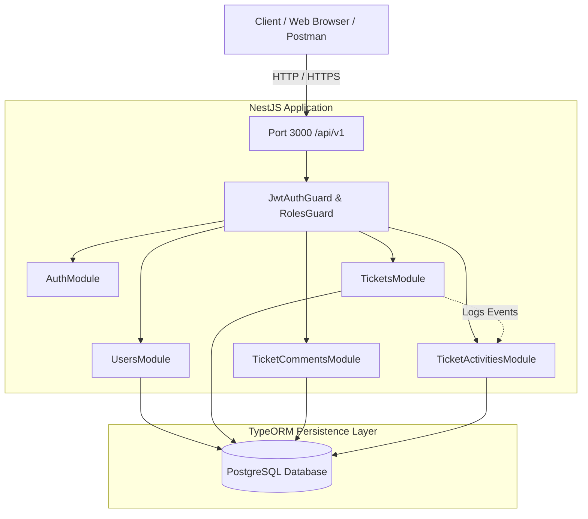
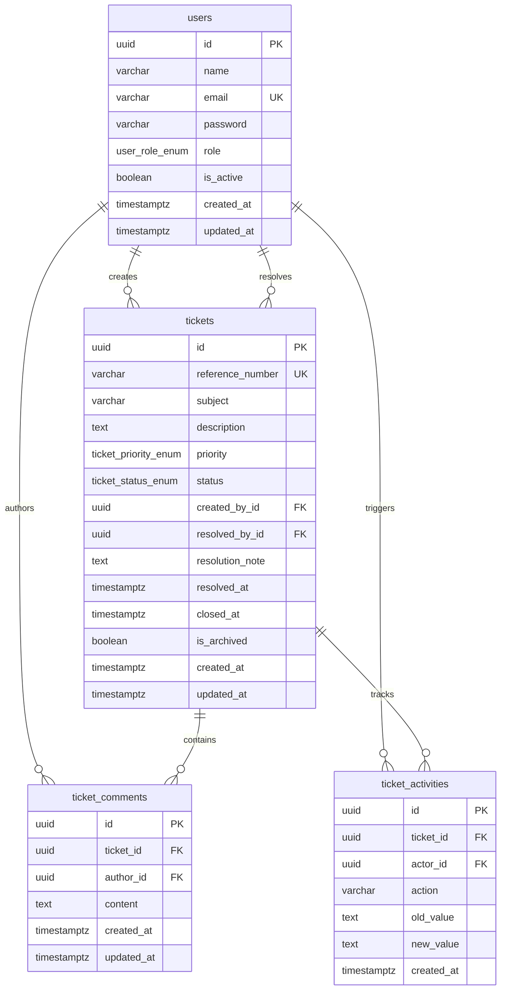

# HelpDesk – Full-Stack Support Ticket Management System with Role-Based Access Control

[](https://nestjs.com/)
[](https://www.postgresql.org/)
[](https://typeorm.io/)
[](https://pnpm.io/)
[](https://www.typescriptlang.org/)
[](LICENSE)

An enterprise-ready, modular academic group project implementing a complete Support Ticket Management System with strict Role-Based Access Control (RBAC), database migrations, JWT authentication, and automated audit trails.

---

## 👥 Academic Project Team & Module Ownership

| Member Name | Student Responsibility | Git Branch | Module Ownership |
|---|---|---|---|
| **MD TANVIR RAHMAN** | Member 1 (Lead) | `tanvir-user-management` | Authentication, User Management, JWT, RBAC |
| **MD ARAFAT RAHMAN** | Member 2 | `arafat-ticket-management` | Complaint / Ticket Management & Workflows |
| **TANBIR RAFAT NABIL** | Member 3 | `tanbir-ticket-comments` | Ticket Comments & Threaded Communication |
| **ALL MEMBERS** | Group Integration | `main` | Full Integration, Audit Trail, Docs, E2E Tests |

---

## 🚀 Key Features

- **Authentication & RBAC:**
  - Client self-registration (`POST /api/v1/auth/register`).
  - Secure login (`POST /api/v1/auth/login`) with bcrypt password hashing (12 rounds) and JWT signing.
  - Role hierarchy: `ADMIN`, `STAFF`, `CLIENT`.
  - Inactive user login denial.
  - Admin-only staff account creation and user deactivation.

- **Complaint / Ticket Lifecycle:**
  - Automated reference number generation: `HD-YYYY-XXXX-RAND`.
  - Four-stage status flow: `OPEN` ➔ `IN_PROGRESS` ➔ `RESOLVED` ➔ `CLOSED`.
  - Priority levels: `LOW`, `MEDIUM`, `HIGH`, `URGENT`.
  - Staff resolution notes tracking resolver identity and timestamp.
  - Ticket reopening and soft-archiving preserving historical records.
  - Multi-field text search, filtering (status, priority, date), pagination, and sorting.

- **Threaded Communication:**
  - Two-way conversation thread between clients and support staff.
  - Ownership validation: Clients can only access and comment on their own tickets.
  - Edit and delete rights restricted to comment author or Administrator.
  - Chronological conversation display.

- **System Audit Trail (`ticket_activities`):**
  - Immutable audit logs tracking ticket creation, status changes, priority shifts, resolution notes, and closures.

- **Developer Experience & Infrastructure:**
  - Interactive Swagger OpenAPI documentation at `/api/docs`.
  - Strict database migrations using TypeORM CLI (`synchronize: false`).
  - Containerization with Docker & Docker Compose (PostgreSQL 16, pgAdmin 4, NestJS app).
  - 58 automated unit and end-to-end integration tests.

---

## 🛠️ Technology Stack

- **Backend Framework:** NestJS 11
- **Language:** TypeScript 5.7+
- **Package Manager:** pnpm 12
- **Database:** PostgreSQL (v16 in Docker / v18 native)
- **Object Relational Mapper:** TypeORM 0.3+
- **Authentication:** Passport JWT (`@nestjs/jwt`, `passport-jwt`)
- **Password Encryption:** bcrypt
- **Input Validation:** `class-validator` & `class-transformer`
- **Documentation:** Swagger / OpenAPI
- **Testing:** Jest & Supertest
- **Containers:** Docker & Docker Compose
- **Database GUI:** pgAdmin 4

---

## 🏛️ System Architecture



---

## 🗄️ Database Design (Entity-Relationship)



---

## 📂 Project Folder Structure

```text
helpdesk/
├── src/
│   ├── modules/
│   │   ├── auth/                      # Authentication & JWT strategies
│   │   │   ├── dto/
│   │   │   ├── strategies/
│   │   │   ├── auth.controller.ts
│   │   │   ├── auth.service.ts
│   │   │   └── auth.module.ts
│   │   │
│   │   ├── users/                     # User management & Staff administration
│   │   │   ├── dto/
│   │   │   ├── entities/
│   │   │   ├── users.controller.ts
│   │   │   ├── users.service.ts
│   │   │   └── users.module.ts
│   │   │
│   │   ├── tickets/                   # Complaint tickets & status workflows
│   │   │   ├── dto/
│   │   │   ├── entities/
│   │   │   ├── tickets.controller.ts
│   │   │   ├── tickets.service.ts
│   │   │   └── tickets.module.ts
│   │   │
│   │   ├── ticket-comments/           # Threaded communication & comments
│   │   │   ├── dto/
│   │   │   ├── entities/
│   │   │   ├── ticket-comments.controller.ts
│   │   │   ├── ticket-comments.service.ts
│   │   │   └── ticket-comments.module.ts
│   │   │
│   │   └── ticket-activities/         # Immutable audit trail
│   │       ├── entities/
│   │       ├── ticket-activities.controller.ts
│   │       ├── ticket-activities.service.ts
│   │       └── ticket-activities.module.ts
│   │
│   ├── common/                        # Shared decorators, guards, filters, enums
│   │   ├── decorators/
│   │   ├── enums/
│   │   ├── filters/
│   │   ├── guards/
│   │   ├── interceptors/
│   │   └── interfaces/
│   │
│   ├── config/                        # Environment configuration service
│   │   └── configuration.ts
│   │
│   ├── database/                      # Migrations, seed scripts, DataSource
│   │   ├── migrations/
│   │   ├── seeds/
│   │   └── data-source.ts
│   │
│   ├── app.controller.ts
│   ├── app.module.ts
│   └── main.ts
│
├── test/                             # Supertest E2E integration test suite
│   ├── app.e2e-spec.ts
│   └── jest-e2e.json
│
├── docs/                             # Full architectural & demonstration documents
│   ├── architecture.md
│   ├── database-design.md
│   ├── api-documentation.md
│   ├── git-workflow.md
│   ├── tanvir-demonstration.md
│   ├── arafat-demonstration.md
│   ├── tanbir-demonstration.md
│   └── integration-guide.md
│
├── .env.example
├── .env.development
├── .env.test
├── .env.production.example
├── docker-compose.yml
├── Dockerfile
├── package.json
└── README.md
```

---

## ⚡ Installation & Quick Start

### 1. Clone & Install Dependencies
```bash
git clone <repo_url> helpdesk
cd helpdesk
pnpm install
```

### 2. Configure Environment
Copy `.env.example` to `.env.development`:
```bash
cp .env.example .env.development
```

Ensure PostgreSQL credentials in `.env.development` match your local environment:
```env
NODE_ENV=development
APP_PORT=3000
APP_URL=http://localhost:3000

DB_HOST=localhost
DB_PORT=5432
DB_USERNAME=postgres
DB_PASSWORD=your_password
DB_DATABASE=helpdesk_db

JWT_SECRET=super_secret_jwt_key_helpdesk_2026_dev
JWT_EXPIRES_IN=1d
BCRYPT_SALT_ROUNDS=12

ADMIN_NAME=System Administrator
ADMIN_EMAIL=admin@helpdesk.com
ADMIN_PASSWORD=Admin@12345
```

### 3. Database Migrations & Initial Seed
```bash
# Execute initial schema migration
pnpm run migration:run

# Seed initial system administrator account
pnpm run seed
```

### 4. Run Development Server
```bash
pnpm run start:dev
```
- API Base URL: `http://localhost:3000/api/v1`
- Interactive Swagger Documentation: `http://localhost:3000/api/docs`

---

## 🧪 Testing

```bash
# Run unit tests across all 5 modules (28 tests)
pnpm test

# Run full end-to-end integration test suite (30 tests)
pnpm run test:e2e

# Run test coverage
pnpm run test:cov
```

---

## 🐳 Docker & pgAdmin 4 Setup

Start all services (PostgreSQL, pgAdmin 4, Backend API):
```bash
docker compose up -d --build
```

### Connecting pgAdmin 4
1. Open your browser to `http://localhost:5050`.
2. Login with:
   - Email: `admin@helpdesk.com`
   - Password: `Admin@12345`
3. Click **Add New Server**:
   - **General -> Name:** `HelpDesk Postgres`
   - **Connection -> Host name:** `postgres` (or `localhost` if connecting from outside Docker)
   - **Port:** `5432`
   - **Maintenance DB:** `helpdesk_db`
   - **Username:** `postgres`
   - **Password:** `<DB_PASSWORD>`

---

## 📑 Detailed Documentation Links

- [System Architecture & Sequence Flows](docs/architecture.md)
- [Database Design & Schema Constraints](docs/database-design.md)
- [REST API Endpoint Reference](docs/api-documentation.md)
- [Git Branch & Workflow Strategy](docs/git-workflow.md)
- [Member 1 (Tanvir) Demonstration Guide](docs/tanvir-demonstration.md)
- [Member 2 (Arafat) Demonstration Guide](docs/arafat-demonstration.md)
- [Member 3 (Tanbir) Demonstration Guide](docs/tanbir-demonstration.md)
- [Integration & Deployment Guide](docs/integration-guide.md)
