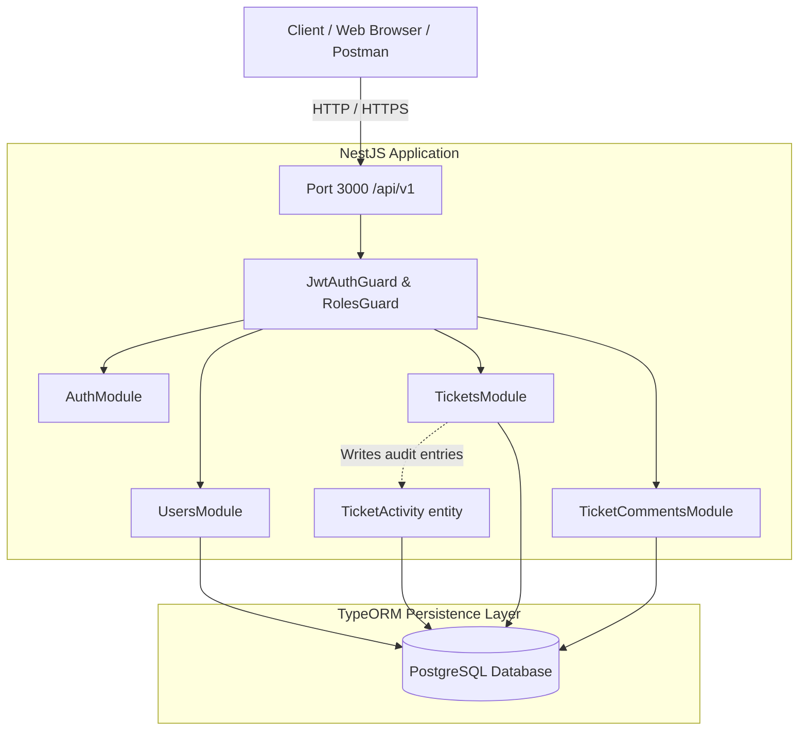
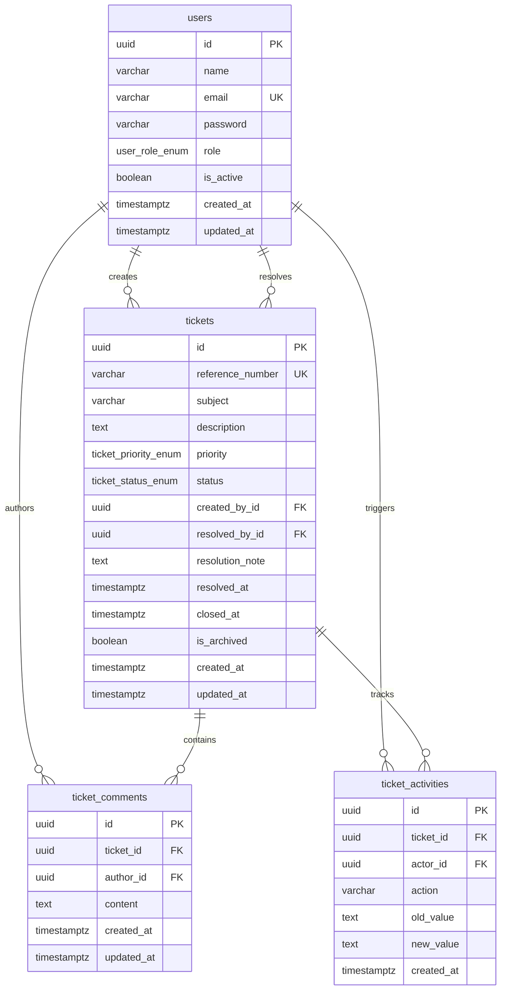

# HelpDesk – Full-Stack Support Ticket Management System with Role-Based Access Control

[](https://nestjs.com/)
[](https://www.postgresql.org/)
[](https://typeorm.io/)
[](https://pnpm.io/)
[](https://www.typescriptlang.org/)

An enterprise-ready, modular academic group project implementing a complete Support Ticket Management System with strict Role-Based Access Control (RBAC), database migrations, JWT authentication, and automated audit trails.

---

## 👥 Academic Project Team & Module Ownership

| Member Name | Student Responsibility | Git Branch | Module Ownership |
|---|---|---|---|
| **MD TANVIR RAHMAN** | Member 1 (Lead) | `tanvir-user-management` | Authentication, User Management, JWT, RBAC |
| **MD ARAFAT RAHMAN** | Member 2 | `arafat-ticket-management` | Complaint / Ticket Management & Workflows |
| **TANBIR RAFAT NABIL** | Member 3 | `tanbir-ticket-comments` | Ticket Comments & Threaded Communication |
| **ALL MEMBERS** | Group Integration | `main` | Full integration of all modules (merged from the three branches above) |

---

## 🚀 Key Features

- **Authentication & RBAC:**
  - Client self-registration (`POST /api/v1/auth/register`).
  - Secure login (`POST /api/v1/auth/login`) with bcrypt password hashing (12 rounds) and JWT signing.
  - Role hierarchy: `ADMIN`, `STAFF`, `CLIENT`.
  - Inactive user login denial.
  - Admin-only staff account creation and user deactivation.

- **Complaint / Ticket Lifecycle:**
  - Automated reference number generation: `HD-YYYY-XXXX-RAND`.
  - Four-stage status flow: `OPEN` ➔ `IN_PROGRESS` ➔ `RESOLVED` ➔ `CLOSED`.
  - Priority levels: `LOW`, `MEDIUM`, `HIGH`, `URGENT`.
  - Staff resolution notes tracking resolver identity and timestamp.
  - Ticket reopening and soft-archiving preserving historical records.
  - Multi-field text search, filtering (status, priority, date), pagination, and sorting.

- **Threaded Communication:**
  - Two-way conversation thread between clients and support staff.
  - Ownership validation: Clients can only access and comment on their own tickets.
  - Edit and delete rights restricted to comment author or Administrator.
  - Chronological conversation display.

- **System Audit Trail (`ticket_activities`):**
  - Audit log entries (written by `TicketsService`) tracking ticket creation, status changes, priority shifts, resolution notes, and closures.

- **Developer Experience & Infrastructure:**
  - Interactive Swagger OpenAPI documentation at `/api/docs`.
  - Strict database migrations using TypeORM CLI (`synchronize: false`).
  - Containerization with Docker & Docker Compose (PostgreSQL 16, pgAdmin 4, NestJS app).
  - 24 automated unit tests (Jest) across the auth, users, tickets and ticket-comments services.

---

## 🛠️ Technology Stack

- **Backend Framework:** NestJS 11
- **Language:** TypeScript 5.7+
- **Package Manager:** pnpm 12
- **Database:** PostgreSQL (v16 in Docker / v18 native)
- **Object Relational Mapper:** TypeORM 0.3+
- **Authentication:** Passport JWT (`@nestjs/jwt`, `passport-jwt`)
- **Password Encryption:** bcrypt
- **Input Validation:** `class-validator` & `class-transformer`
- **Documentation:** Swagger / OpenAPI
- **Testing:** Jest & Supertest
- **Containers:** Docker & Docker Compose
- **Database GUI:** pgAdmin 4

---

## 🔌 API Overview

All routes are prefixed with `/api/v1` and require a JWT (`Authorization: Bearer <token>`) unless marked public.

| Module | Endpoints | Access |
|---|---|---|
| Auth | `POST /auth/register`, `POST /auth/login` | Public |
| Auth | `POST /auth/logout`, `GET /auth/me` | Authenticated |
| Users | `POST /users`, `GET /users`, `GET /users/:id`, `PATCH /users/:id`, `DELETE /users/:id` | Mixed, see Swagger (create/list/deactivate are `ADMIN`) |
| Tickets | `POST /tickets`, `GET /tickets`, `GET /tickets/my-tickets`, `GET /tickets/:id` | Authenticated |
| Tickets | `PATCH /tickets/:id`, `PATCH /tickets/:id/status`, `PATCH /tickets/:id/resolve`, `PATCH /tickets/:id/close`, `PATCH /tickets/:id/reopen`, `DELETE /tickets/:id` | Role-restricted, see Swagger (several are `STAFF`/`ADMIN`) |
| Comments | `POST /tickets/:ticketId/comments`, `GET /tickets/:ticketId/comments` | Authenticated (clients only on their own tickets) |
| Comments | `GET /ticket-comments/:id`, `PATCH /ticket-comments/:id`, `DELETE /ticket-comments/:id` | Author or `ADMIN` for edit/delete |
| System | `GET /health` | Public |

Full, always-current request/response schemas are in Swagger at `http://localhost:3000/api/docs`.

---

## 🏛️ System Architecture



---

## 🗄️ Database Design (Entity-Relationship)



---

## 📂 Project Folder Structure

```text
helpdesk/
├── src/
│   ├── modules/
│   │   ├── auth/                  # Registration, login, JWT strategy
│   │   ├── users/                 # User management & staff administration
│   │   ├── tickets/               # Tickets, status workflow, audit logging
│   │   ├── ticket-comments/       # Threaded comments on tickets
│   │   └── ticket-activities/     # TicketActivity entity (audit trail)
│   │
│   ├── common/                    # Shared decorators, enums, filters,
│   │   ├── decorators/            #   guards, interceptors, interfaces
│   │   ├── enums/
│   │   ├── filters/
│   │   ├── guards/
│   │   ├── interceptors/
│   │   └── interfaces/
│   │
│   ├── config/configuration.ts    # Environment configuration
│   ├── database/                  # data-source.ts, migrations/, seeds/
│   ├── app.controller.ts          # GET /health
│   ├── app.module.ts
│   └── main.ts                    # Bootstrap, /api/v1 prefix, Swagger
│
├── docs/
│   └── tanbir-demonstration.md    # Ticket comments demo guide
│
├── .env.example
├── .env.production.example
├── docker-compose.yml
├── Dockerfile
├── package.json
└── README.md
```

---

## ⚡ Installation & Quick Start

### 1. Clone & Install Dependencies
```bash
git clone <repo_url> helpdesk
cd helpdesk
pnpm install
```

### 2. Configure Environment
Copy `.env.example` to `.env.development` (env files are git-ignored, so each developer creates their own):
```bash
cp .env.example .env.development
```

Ensure PostgreSQL credentials in `.env.development` match your local environment:
```env
NODE_ENV=development
APP_PORT=3000
APP_URL=http://localhost:3000

DB_HOST=localhost
DB_PORT=5432
DB_USERNAME=postgres
DB_PASSWORD=your_password
DB_DATABASE=helpdesk_db

JWT_SECRET=replace_with_a_secure_secret_min_32_chars_long
JWT_EXPIRES_IN=1d
BCRYPT_SALT_ROUNDS=12

ADMIN_NAME=System Administrator
ADMIN_EMAIL=admin@helpdesk.com
ADMIN_PASSWORD=Admin@12345
```

### 3. Database Migrations & Initial Seed
```bash
# Execute initial schema migration
pnpm run migration:run

# Seed initial system administrator account
pnpm run seed
```

### 4. Run Development Server
```bash
pnpm run start:dev
```
- API Base URL: `http://localhost:3000/api/v1`
- Interactive Swagger Documentation: `http://localhost:3000/api/docs`

---

## 🧪 Testing

```bash
# Run the unit tests (24 tests across 4 service specs)
pnpm test

# Run test coverage
pnpm run test:cov
```

> The `test:e2e` script is defined in `package.json`, but there is no `test/` folder yet, so end-to-end tests are not available.

---

## 🐳 Docker & pgAdmin 4 Setup

Start all services (PostgreSQL, pgAdmin 4, Backend API):
```bash
docker compose up -d --build
```

### Connecting pgAdmin 4
1. Open your browser to `http://localhost:5050`.
2. Login with:
   - Email: `admin@helpdesk.com`
   - Password: `Admin@12345`
3. Click **Add New Server**:
   - **General -> Name:** `HelpDesk Postgres`
   - **Connection -> Host name:** `postgres` (or `localhost` if connecting from outside Docker)
   - **Port:** `5432`
   - **Maintenance DB:** `helpdesk_db`
   - **Username:** `postgres`
   - **Password:** `<DB_PASSWORD>`

---

## 📑 Documentation

- Interactive API reference: Swagger at `/api/docs` when the server is running.
- [Ticket Comments Demonstration Guide](docs/tanbir-demonstration.md)
